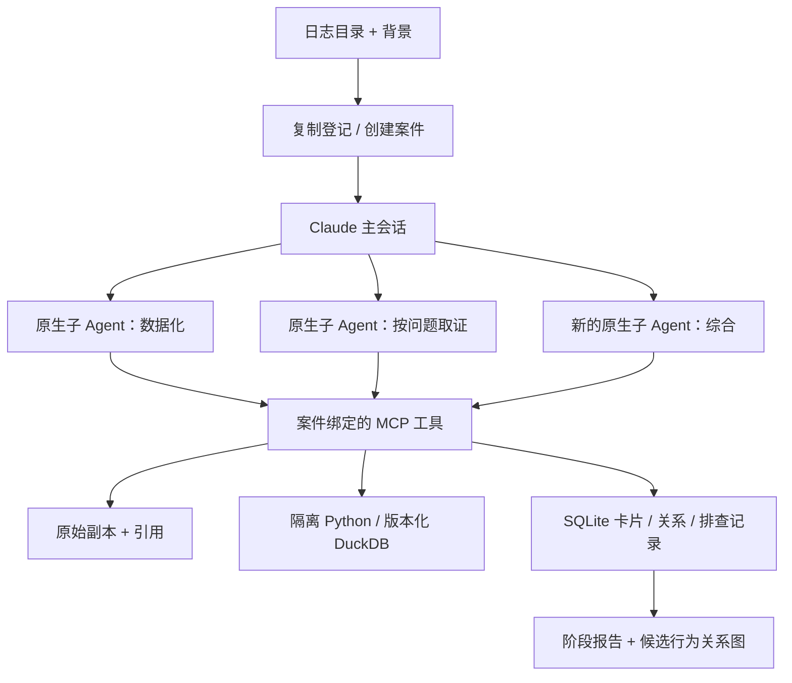

# IRKit：个人日志应急响应助手

输入一个日志目录和可选背景，使用 **Claude Code 原生主会话与子 Agent** 完成数据化、取证和综合研判。Python 层提供案件存储和 MCP 工具，不实现模型调度器。

当前是可运行的首版原型。工程结构和可复现验证命令见本文后续章节。

## 开始使用

开发环境：macOS、Python 3.12+、uv、已安装并配置模型服务的 Claude Code（本机验证版本 2.1.283）。当前执行隔离依赖 macOS `sandbox-exec`；其他平台会拒绝执行脚本与 SQL，不会降级为无隔离运行。

```sh
git clone https://github.com/Aecous/IRKit.git
cd IRKit
uv sync --locked
uv run irkit doctor

uv run irkit investigate "/绝对路径/日志目录" \
  --background "昨晚 22:00 左右网站出现异常，请检查入口、影响范围和后续行为"
```

背景也可以是 UTF-8 文件；没有背景时省略参数：

```sh
uv run irkit investigate "/绝对路径/日志目录" --background-file "/绝对路径/背景.txt"
uv run irkit investigate "/绝对路径/日志目录"
```

建议背景包括时间及其时区、系统关系、已经观察到的现象、已知正常操作、需要重点核实的问题。无需预先给出攻击方式或 IOC。

默认案件保存到 `~/Library/Application Support/IRKit/cases/`。初始化会复制输入并计算 SHA-256，因此要有相应磁盘空间。使用 `--cases-dir /其他/案件目录` 可更换位置，不能与输入目录重叠。

仅登记、不调用模型：

```sh
uv run irkit investigate "/绝对路径/日志目录" --prepare-only
uv run irkit inspect "/绝对路径/案件目录"
uv run irkit resume "/绝对路径/案件目录"
```

`resume` 开启新 Claude 会话，由其根据黑板继续案件；不保证接回某个旧子 Agent 的模型上下文。已完成任务和中间成果不会丢失。CLI 启动后由 Claude 自己管理原生子 Agent。

默认交互式运行。需要脚本方式运行时，可使用 `--print --budget 3`；预算参数交给 Claude CLI，仅适用于非交互模式，其实际计费取决于你的模型服务。达到预算或中断后可通过 `resume` 继续。

## 查看 Claude 会话与 Agent 工作台

已有案件无需重新入库。运行 `uv run irkit web "/绝对路径/案件目录" --port 8765`，访问 http://127.0.0.1:8765。

如果已将工作台案件路径保存到本地的 `.validation/workbench-root.txt`，可以用它重启：

```sh
uv run irkit web "$(cat .validation/workbench-root.txt)" --port 8765
```

左侧选择主 Agent 或原生子 Agent，中间查看任务指令、实际消息、折叠的思考与工具调用/返回，右侧查看关联卡片、检查及补证问题。没有单独的解码正文页面；工具返回仍可按需展开。会话可切换、历史可分页、断线按事件序号续传，搜索作用于已加载内容。

向上滚动会暂停跟随，到顶部自动加载更早消息；“回到最新消息”恢复跟随。新消息和后台刷新保留正在阅读的消息位置、已展开的工具详情。可筛选分析与结论、工具调用、错误与中断；窄窗口默认收起证据面板，点击卡片会打开详情。Agent 导航使用完整会话索引，因此加载后半段消息也能识别最初派发的 Agent。

点击右上角 **下发扫描任务** 可直接启动日志调查：

- **继续当前案件**：填写本轮目标，默认复用已有数据；尚未入库时可取消“跳过数据初始化”。
- **复用入库数据，重新独立分析**：创建空白调查，复用当前案件已发布的只读分区和原始日志，不继承旧卡片、任务、检查及会话。使用硬链接避免重复占用大日志空间；不需要重新入库。
- **分析新的日志目录**：填写本机绝对路径与可选背景。后台复制登记日志，创建独立案件，再启动 Claude。大日志需要相应磁盘空间；40 GB 已入库案例优先选择继续当前案件。
- 预算传给 Claude CLI；任务栏区分启动、登记、运行、报告已交付、未完成交付、中断和失败。点击“查看运行”切换案件，“运行日志”查看启动及退出信息。
- 每个工作台同时执行一项调查，重复提交复用同一任务；浏览器关闭和查看服务重启不结束已经下发的调查。当前版本不提供网页中止按钮。
- 请求与状态保存在启动案件的 `web-jobs/`，新案件默认保存在其上级的 `web-cases/`；可通过 `web-jobs/config.json` 的 `cases_dir` 指定位置。
- 网页下发指现有的日志应急调查，不是主动端口/漏洞扫描。后台只启动现有 `run_case.py`，子任务仍由 Claude 原生 Agent 调度。页面写操作仅接受本机同源请求及页面令牌。

也可以在终端启动已登记案件并记录对话：

```sh
uv run python scripts/run_case.py "/绝对路径/案件目录" \
  --analysis-only --budget 8 \
  --instruction "沿关键卡片追查前置条件与后续结果，完成补证和独立综合复核后生成报告。"
```

运行约定（2026-11-15）：

- 子 Agent 使用 Claude 原生前台调用，主 Agent 等待取证返回后再派发综合；Web 调查进程仍在后台运行，关页面不影响任务。没有新增外部模型调度器。
- 启动环境设置 `CLAUDE_CODE_DISABLE_BACKGROUND_TASKS=1`，并将 `CLAUDE_CODE_PRINT_BG_WAIT_CEILING_MS=0` 作为兼容兜底。当前本机 Claude Code 2.1.283 包含两项配置；[官方环境变量说明](https://code.claude.com/docs/en/env-vars) 说明前者禁用子 Agent 自动后台化。
- 启动脚本默认无固定总时限；需要时可传 `--timeout-seconds 7200`。显式超时退出码 124。预算仍由 `--budget` 控制。
- 退出码 0 不等于调查交付。校验本轮事件及对象变更，要求本轮任务完成、有效新报告文件存在、综合任务实际交付该报告且未发生子 Agent 停止或模型错误。旧报告不能替本轮交付。
- 新事件流程还核对原生 `ir-synthesize` 子 Agent 的实际报告生成与任务交付事件。主 Agent 自行创建综合角色任务、登记 supported，不等于完成独立综合复核。
- 会话结束但交付未完成时脚本退出码为 2，前端显示具体未完成原因；报告生成仍是草稿，等待人工审阅，不表示证据已确认。
- 旧 Web 任务的误报完成会按其时间窗口重新核验，保存原状态供追溯。原始证据卡片和会话不改写。

`run_timeline.py` 通过此入口运行，新时间线调查会自动记录消息。直接交互式 `irkit investigate/resume` 尚未接入流式记录；需要 Web 对话记录时使用上述脚本。

- `db/case.sqlite` 的 `runtime_events` 保存原生事件及会话/Agent/任务关联；`sessions/events-N.jsonl` 保留 CLI 原始输出，`response-N.json` 保留最终返回，`stderr-N.txt` 保留错误。
- `parent_tool_use_id` 识别子 Agent，工具 ID 关联调用与返回。主会话负责调度，Web 和 Python 不引入第二套调度器。
- 思考仅展示运行时实际返回的 thinking 块；只有 token 计数时不补写思考。旧运行未捕获的对话无法回填。
- 状态来自派发、返回和结束事件；缺结束事件时显示“最近有活动/未收到结束事件”，不据此断言仍正常运行。网页连接状态与 Agent 执行状态分开。
- 页面参考 [DeepSeek Superagent Panel](https://github.com/deepseek-ai/dsh-superagent-prototype/blob/main/docs/005-panel.md) 的状态与历史呈现，以及本地 muteki 的会话和 worker 分栏。ARTEX 仅参考可访问的 [poimodev/artex 分支](https://github.com/poimodev/artex) 功能说明，未接入其运行框架。

## 通用解码与节点补证

新任务通过 `submit_event` 提交结构化事件卡：事件名称、环境与资产、已观察事实、可能原因、已观察结果、潜在后果，以及前置/后续待查问题。推测与事实分开，统计和排除过程保存在 check 中，避免每次查询产生一张卡片。更新同一事件使用 `revise_event`，保留修订历史。

主 Agent 每轮读取 `event_queue`，将关键问题绑定原卡片及修订号，派给原生取证 Agent；取证提交新事件和 check，再由综合 Agent 独立复核。页面直接展示每个方向处于待查、已派发、待复核还是已复核，并可打开关联任务和检查。无需追查或证据范围已经到边界时，必须写明原因，边界结论关联实际检查。未解决的关键问题会阻止最终报告交付，可生成标明缺口的进展报告。

解码由分析线索触发：看到编码特征、可疑协议或需要还原的内容后才调用转换工具。不会因为日志是 HTTP 就要求提供不存在的请求体或响应体；HTTP 状态、响应字节数和响应正文也分别解释。

`start_decode(dataset_ids, filters, chain?, task_id?)` 固定数据集、host/domain/path/method/时间范围，筛出全部候选原始行；`decode_batch(run_id)` 每次最多处理 2,000 条，可重入续跑；`read_decoded` 按操作和关键词分页读取产物。运行保存 `runs/run_ID/decoded.sqlite`，含原始 source/line、转换步骤、哈希、结果及失败原因。

内置 gzip、Base64（含 URL-safe）、hex、URL 编码，支持最多六层组合，单条转换上限 128 KiB。gzip 是压缩，Base64 是编码；真正加密的数据仍需算法、密钥和专门转换逻辑，未知协议交给数据化任务并记录缺口。自动模式只认可结构化终点，纯文本可显式指定 chain。当前全量入口适配单行 JSONL 的 `request_body`；其他字段/多行协议由数据化 Agent 扩展。

筛选阶段失败需要新建解码运行；筛选完成后的解码阶段支持续跑。候选总量、处理量、解码状态和语义分类覆盖分别统计。**解码成功不代表语义已识别；未解码或未分类的记录不能支持完整排除结论。** `submit_check(decode_run_ids=...)` 记录覆盖快照，程序拒绝用不完整覆盖提交 `zero_hits`。

`decode_batch` 与 `read_decoded` 返回 `overview`：全体已处理记录的格式、语义状态、SQL 操作计数和每类原文锚点；`matching_total` 仅计当前筛选结果。即使某页全是读取请求，模型仍能看到少量配置/数据变更类别。概览是工具统计，不代表利用成功，当前语义提取仍需模型核查未知类别。

关键卡片通过 `propose_followup` 提出前置（upstream）、后续（downstream）或双向问题，写清验证条件。问题绑定起点卡片修订；主 Agent 派发，取证 Agent 提交关联 task_id 的卡片与 check，综合 Agent 用 `review_followup` 复核后再生成报告。报告列出实查范围、查询、覆盖、结论及缺口。旧起点修订任务保留为历史缺口；当前起点下已完成但未复核的任务会阻止出报告。

## 模型连接

沿用本机 Claude 的登录态，并从用户 Claude `settings.json` 中仅提取模型/服务地址/认证环境变量；不加载该配置中的 hooks、插件或通用执行工具。认证变量只传到启动进程环境，不写入案件配置。

这意味着使用的是 **Claude Code 的原生编排能力**，实际推理模型取决于你的既有配置；如果配置映射到第三方模型，不会自动把它变成 Anthropic Claude。使用 `--model MODEL_ID` 指定当前服务确实提供的模型。网关 401/403/503、模型不支持或额度不足需要在模型服务配置中解决，工具不会悄悄切换账号或服务。

依赖 `apiKeyHelper`、复杂企业登录钩子或未列入白名单的提供方变量的配置，首版未自动迁移；可使用当前进程环境传入认证。不要把 AK/SK 或模型密钥放入背景、证据或工程文件。

云模型会收到工具返回的日志样本和查询结果；本地存储与执行隔离不代表离线推理。

## 调查过程



- 数据化 Agent 根据样本编写 Python，不要求你事先确定日志格式。内置 nginx、Java、IIS、Windows 方法说明，通用读取器支持文本、gzip 文本、EVTX XML 记录。
- 大规模 JSONL 使用 `start_jsonl_ingest`。模型选择 JSON 字段映射，本地作业按文件分批写入 DuckDB。每批目标上限约 32 MiB 原始数据或 50,000 行。批次数据与行号、字节偏移在同一事务提交。`ingest_status` 查看进度，`resume_jsonl_ingest` 续跑失败源，已经发布的分区会跳过。
- `ds_ID_core` 提供来源字段、UTC 时间、请求路径和原始查询串，以及数值状态码、响应大小、耗时。多分区使用 `ir_all_core_events`。`ds_ID` 通过行号关联请求明细，提供完整令牌、请求体和令牌指纹。转发链首项标为未核实来源候选。
- 每个分区保留原始行号、解析状态、编码修复标记和字段覆盖。源里已观察到的关键字段若未投影，作业标为 `partial`，需要补齐映射后创建新作业。单条原始记录超过 2 MiB 时保留原文引用并标为 `oversized`。坏字节在当前批次转义，原始副本完整保留。
- 模型通过 `records(source_id)` 读取原文，`emit(fields, refs)` 生成带原始位置的行。Java 多行堆栈可以引用一段物理行范围。发布器校验引用、结构和数量，不替模型证明解析语义正确。
- 取证与综合 Agent 可以用 `inspect_request_bodies` 检查最多 12 条已索引 JSONL 原始行。工具从原始字节恢复 gzip，每条解压最多 64 KiB，返回路由配置键、SQL 操作类型、表名、简单账号候选和原始引用。工具保留解码失败或超限状态，只做请求内容摘要。完整证据仍保存在原件中。
- 路由调查从首见访问向前查配置提交、读回和刷新，分别记录最早提交和首次可见访问。SQL 端点调查从核心表筛选出原始行，解码后按环境、账号、来源候选和时间关联用户表写入与登录。报告应核对登录前是否已有查询，并写清解码覆盖及实际生效的证据缺口。
- 每个数据集是不可变 DuckDB 文件；查询可连接多个数据集。时间字符串保持原样，需要比较时在 SQL 中明确转换及解释时区。
- 取证 Agent 提交观察/推断卡片、实际查询和检查范围。主会话默认最多两个并行子 Agent，提示词设定默认三轮、十二个任务的调查边界；这是原生运行时配置与工作规则，不是另一个自建强制配额引擎。
- 综合 Agent 在新上下文中按需取卡片，回查证据，形成候选关系与缺口。时间接近、同 IP、HTTP 200 不会被规则自动确认为攻击链。
- 已有卡片需要补证时，在主会话指定卡片 ID 和待回答的问题。主会话创建关联卡片当前修订的取证任务，并明确允许查询的数据集。取证 Agent 提交关联任务的 `check`，查到新证据时还要提交证据卡片。综合 Agent 回查这些产物并记录复核结果。报告的「关键问题补证与复核」可逐题查看实查范围、查询 ID、结论和证据缺口。

报告保存在案件 `reports/` 下，是带生成时间和对象修订快照的 Markdown 草稿。数据或卡片更正后，依赖它们的卡片、关系、检查和报告元数据会变为 `stale`；历史报告文件保留，需重新生成当前报告。

人工审核某张卡片：

```sh
uv run irkit review "/案件目录" card_实际ID 1 reviewed "已核对原始日志及其上下文"
```

`1` 是当前修订号；另一个决定是 `rejected`。模型工具没有人工批准入口。

## 可复现验证

```sh
uv run pytest -q
node --test tests/*.mjs
uv run ruff check src tests scripts
uv run python scripts/demo.py
```

`demo.py` 只处理随附的四份合成日志，用固定测试脚本验证：登记 → 数据化 → SQL 关联 → 原文回查 → 卡片 → 关系 → 报告。它不调用模型，也不代表模型自主调查能力。`examples/fixture_transform.py` 仅适用于这些测试样例，不是通用生产解析器。

实际 Claude 联调（会调用你配置的模型服务）：

```sh
uv run python scripts/live_smoke.py
```

该脚本只发送 `examples/logs/` 的合成数据，输出位于 `.validation/live-smoke/`，最多各安排一个数据化、取证和综合子 Agent。它是开发测试入口，不属于产品运行时的调度器。

## 当前边界

- 首版只接本地目录。SSH 远程采集、云 AK/SK 调用和自动处置尚未实现。
- 模型 Python 脚本仅能读获准证据副本、可信运行环境以及自己的运行目录；禁用网络，不能修改源副本。超时默认 90 秒、最高 300 秒；`emit` 路径最多 100 万行、单文件输出 256 MiB。通用 JSONL 批量入库不经过 `emit`，每源受限 1,800 秒、1.5 GiB DuckDB 内存及 16 GiB 单文件；SQL 使用 1 GiB 内存和 8 GiB 临时空间/单文件上限。没有总案件磁盘硬配额，也不是对抗 OS 漏洞的容器集群隔离。
- 脚本限额错误、解码错误、二进制不支持、跳过链接、SQL 错误与截断均应留在记录中。最多保存 10,000 行查询结果，默认 1,000；统计可以用聚合 SQL。检查 `truncated`，不要将展示样本当完整结果。
- UTF-16 有 BOM 的文件可识别为文本，读取时指定 `encoding="utf-16"`；其他编码需模型明确指定。未知二进制先登记缺口。实际 EVTX 读取入口已接入 `python-evtx`，尚待真实 EVTX 样本验证，现有 Windows 端到端样例使用 XML。
- 文本在复制时建立 LF 稀疏行索引，UTF-8/GB18030/Latin-1 的行号回查不再从文件头遍历；压缩文本、EVTX 和 UTF-16 仍走相应流式读取。40 GB JSONL 的首轮实测记录位于本机 `.validation/case1/运行问题与评估.md`，不能据此宣称其他格式同样通过大规模验证。
- 卡片状态、引用存在和依赖失效有程序校验；陈述是否成立、范围是否足够、关系是否可靠仍需模型分析与人工复核。
- 本地账户拥有案件文件的控制权。角色工具列表用于分工；MCP 不提供多用户认证。首版不作为多租户安全产品。

## 工程结构

```text
src/irkit/
  cli.py          初始化、检查、恢复入口、Claude 启动
  templates.py    主子 Agent 提示词与场景知识
  mcpserver.py    案件绑定的工具接口
  evidence.py     原件复制、哈希、范围读取与校验
  sandbox.py     macOS 执行边界和超时
  worker.py      隔离数据化和只读 SQL
  datasets.py    数据集发布、查询记录和结果回查
  store.py       SQLite 事务、修订、依赖关系
  board.py       卡片、任务、排查与上下文协议
  report.py      带证据引用的报告与关系图
tests/           行为与边界验证
examples/        合成日志和背景
scripts/         本地演示与显式模型联调
```

黑板以 `objects` 保存不同种类对象，`dependencies` 保存依赖，`changes` 保存历史；可选 `submissions` 防止带相同提交键的重复卡片或冲突重试。逻辑上分离对象，物理上避免为首版引入大量专用表和迁移框架。

## 证据保留与交付复核（2026-11-15）

继续使用 Claude Code 原生主会话与子 Agent、SQLite 对象和现有查询产物；不引入第二套调度或图数据库。

- 卡片、关系的事实状态 `status` 与复核状态 `review_state` 分开。前提变化将后代置为 `needs_review`，保留观察与引用；旧 `stale` 对象也会进入交付阻塞清单。只修改事件问题的边界说明，不再让不变的事实及关联补证重复失效。
- `revise_event` / `revise_card` 默认合并已有证据。删除引用需显式 `remove_evidence`，并记录修订原因；`revise_event` 默认保留未提交的原子结论，撤销用 `remove_claims={key:reason}`。完整历史仍在 SQLite `changes`。
- 综合 Agent 用 `resolve_review` 明确保留、合并或撤销。合并前，目标必须已接收全部原始证据和独有 claims；尚未复核的卡片与关系，即使没列进任务产物，也会阻止最终交付。显式撤销后的历史产物不会永久卡住任务关闭。
- 新 MCP 任务采用事件策略 v2：事件包含 `claims=[{key,statement,level,evidence,scope}]`，每条关键断言有自己的原始行/数据行。`level` 为 request / response / application / inference。`scope.environment` 与卡片一致；`scope.dimensions` 用真实字段和值绑定资产、域名或路径。时间范围若填写，须给 `time_field` 和带时区的 `time_from/time_to`。
- 统计 claim 增加 `statistic={query_id,row,column,unit,population}`，数值由工具读取保存的查询单元格，不能由模型填写。保存 SQL、数据集、完整分组行及截断状态。声称某资产/接口的统计时，结果必须投影对应维度；不能拿无路径分组的多接口合计证明单接口数量。
- `trace_events` 提供按实际 schema、实体和时间窗的有界排序查询，不过滤失败状态。Agent 比较失败、状态变更、重试和后果；查询截断时缩小窗口，凭时间相近不能认定因果。已解码但没有投影为数据列的实体，仍需查询解码产物或补充数据化。
- 综合 Agent 必须 `review_delivery` 对所有卡片、关系逐项复核，再生成最终报告；后续证据变化使该复核快照失效。报告自动包含逐项 claims、原始引用、统计口径和撤销/迁移清单。自由文本的语义、因果及单位解释仍由综合 Agent 和人工审核，不宣称工具可以证明自然语言结论为真。
- 网页展示待复核原因、事实迁移目标、原子结论与证据入口、统计分组/SQL、分页修订历史；详情可滚动，展开内容不会被点击处理器重新加载。默认不展示解码正文。

无需迁移旧数据库；已有报告保持原样。下一次 Agent 启动会重新生成工作区提示词与工具配置。若已有网页进程正在运行，需要重启服务以加载新的历史接口。

### 项目、调查与 Agent 导航

工作台采用「项目 → 调查 → 运行/会话」：顶部切换项目与调查，左侧按照 Claude 实际委派关系显示可折叠的主 Agent / 子 Agent。会话消息、事件卡和报告仍来自对应调查；未记录父关系的 Agent 单独显示，不推造层级。

- 新建项目后，通过「下发调查任务」选择日志目录。继续调查或重新独立分析时，必须在表单中明确选择所属项目与目标/来源调查。
- 独立分析在提交时固定来源调查的可用数据集 ID，复用只读文件并建立空白调查数据库，不继承旧事件卡、补证任务或会话。当前只允许一个后台调查运行，切换页面不取消任务。
- 「调查与运行记录」分别显示执行状态与报告交付状态。运行、调查和项目均可移入回收站并恢复；正在运行的对象及其数据来源调查不能删除。删除单次运行隐藏其运行记录与会话，调查中已产出的卡片和报告仍保留。
- 回收站是工作台的可恢复隐藏，不回收磁盘空间，也不删除原始日志、入库数据、案件数据库。删除项目后需先恢复项目，再恢复单独删除的调查或运行。
- 项目登记在工作台根目录 `web-jobs/projects.json`，带进程锁与原子替换。旧网页案件按明确的 `source_case_dir` / `parent_case` 关系自动归组，不按报告内容猜测归属，也不移动案件目录。页面链接携带项目和案件 ID，后端校验两者归属。

这是本地单人工作台的逻辑隔离，不是多租户权限系统。无需增加账号体系、外部 Runner 或第二套 Agent 调度。

### 来源黑板、并行行为复查与五章报告

来源线索继续存在同一调查的 SQLite `objects` 中（`kind=source_lead`），不增加独立服务。`register_source_lead` 必须引用已提交事件卡，记录 IP、真实来源字段、匹配方式及可信度；登记只代表可疑线索。相同 IP 在直连字段与转发字段中分别登记，不自动等同真实攻击者。

- 后续事件用 `event.source_lead_ids` 显式关联来源；卡片新增、事实修订、撤销关联会在同一事务内更新来源索引并保留历史。只改标题不会触发重复查询。来源判断与复查状态分别显示，历史判断不能代替当前增量复查。
- 主 Agent 分页读取 `source_queue`，通过 `plan_source_review` 固定数据集与事件快照，再使用 Claude 原生二级 `ir-investigate`，每轮最多两个前台调用并行。工具只登记任务与产物，不调度模型，子 Agent 不再递归派发。
- 首次复查查询全部允许数据分区的来源行为，不只过滤已知恶意路径。`source_behavior_overview` 可批量聚合来源及实际 schema 维度，保留 SQL、计数和截断信息；不兼容 schema 分开查询。IP 匹配是字段字符串精确匹配或转发字段首跳匹配，IPv6 不同写法、带端口地址须先建立规范化列。
- 来源任务提交实际 query/check、新事件及 `complete_source_review`，由新的综合 Agent `review_source_task`。运行中新增的外部线索保留为下一轮增量；有效基线 checks 可复用，但新分支仍须执行新查询。失效基线、新分区或撤销事实重新打开复查。未完成或未复核不能交付最终报告；达到扩展边界时保留阶段报告与缺口。
- 新任务采用事件策略 v3。最终报告通过结构化 `report_content` 生成五章：①事件背景与调查范围；②事件结论与影响评估；③攻击时间线与攻击路径；④攻击来源与具体行为；⑤证据缺口与后续建议。结论绑定对象修订及具体 claim；确认影响至少需要 application 层证据，HTTP 成功码本身不够。按环境分别列时间线，原始证据与调查记录放在附录。
- 网页新增「来源黑板」，可查看关联事件、当前增量、复查任务、实际检查行为和证据缺口；来源与事件卡双向跳转。会话侧将对应原生任务显示为「来源行为复查」。报告提供五章导航、证据卡跳转和折叠附录。

独立调查复用只读数据，不继承来源判断或旧卡片。旧报告不改写；已有服务需重启加载后端，新 Agent 启动时生成新版提示词。本轮仅完成合成数据回归与浏览器验证，尚未重新执行 40 GB 付费自主调查。来源是否恶意、行为是否漏查、自然语言结论是否被证据充分支持，仍需综合 Agent 与人工验收。

### 会话身份与复核收敛修复

- 导航索引保存派发、再次唤起、进度和结束事件；通过原生 task_id 将 `SendMessage` 调用映射回原 Agent，避免把心跳显示成无消息的新 Agent。历史分页不再决定 Agent 是否已经返回；选中 Agent 会读取其独立历史，并包含再次唤起的调用别名。
- `review_plan` 返回当前修订及可先处理的父节点、仍被依赖阻塞的对象。有关联的修订和复核按顺序执行，每次重新读取版本；版本冲突保护仍保留。
- `register_environment_alias` 由综合任务明确登记有依据的等价环境名称，引用使用这些名称的卡片，不批量改写历史事实。不同环境不得因为共用域名/IP 自动合并；报告使用明确登记的名称映射。
- 来源事实指纹不再包含纯复核状态及 retain 说明。待复核仍阻止交付，复核确认事实未变后恢复原覆盖，无须重新查询。事实、原始引用、撤销和新增分区变化仍触发增量。
- `complete_source_review(finding_card_ids=[...])` 允许显式引用本轮已分配且版本未变的已有事件，避免为重复发现强制生成新卡或改称 inconclusive。新增命中仍需提供事件卡。
- 截断查询、聚合冒充原始事件、字段范围冲突和缺时区继续拒绝；提示词明确修正范围或保留阶段结果，不关闭证据校验。新提示词/工具仅在新 Claude/MCP 进程中生效，重启网页不代表热更新正在运行的模型会话。
