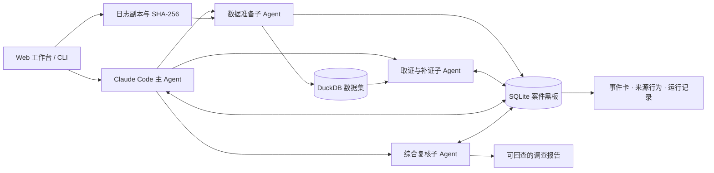

# IRKit · 日志应急响应工作台

IRKit 用于从本地日志还原安全事件。提供日志目录和可选背景，Claude Code 主 Agent 派发数据准备、取证、补证和综合复核，最终报告可以逐条回查到事件卡、查询和原始日志。

## 架构



**Claude Code 原生子 Agent 负责分工，SQLite 黑板负责交接。** 主 Agent 传递任务问题、ID 和数据范围。子 Agent 使用独立上下文，通过 MCP 读写当前案件的产物，返回摘要和引用。

| 角色 | 工作 |
| --- | --- |
| 主 Agent | 根据日志覆盖和已知线索拆分任务，将关键证据缺口交给取证子 Agent 补查。 |
| `ir-prepare` | 识别格式、时间和字段，批量入库或编写转换脚本，将数据行与原文位置关联。 |
| `ir-investigate` | 用 SQL 查询、抽样回查原文，记录事件、前因、后果和待验证问题。 |
| `ir-synthesize` | 复核事件关系、统计口径和关键证据，生成阶段报告或最终报告。 |

黑板保存任务、数据集目录、事件卡、检查和报告引用。事件卡记录带证据的观察，检查记录查询覆盖、结果和证据缺口。来源 IP 及其检查引用保存在事件卡里。同来源的其他操作随事件一起分析，重要的新行为进入普通补证流程。Web 的「来源行为」和报告第四章都由卡片与检查聚合，可查看匹配字段、时间、环境和查询引用。旧案件的来源复查记录仍可查看。

最终报告包含五章：事件概述、攻击链路还原、后渗透操作与影响、攻击时间线与来源、调查局限与处置建议。关键补证未完成时可以保存阶段报告。报告通过证据引用区分原始观察、聚合统计和推断，实际影响以可用的业务证据为准。

### 复核模式与交付状态

默认 `IRKIT_REVIEW_MODE=full`：取证后由独立综合子 Agent 复核并交付。设置 `IRKIT_REVIEW_MODE=off` 启动 Web 或 CLI 时使用快速模式，由主 Agent 汇总最终报告，不强制创建综合任务。模式随本轮运行和报告保存，结束判定使用本轮模式。

工作台交付检查分别列出三类事项；导出正文只保留与调查结论有关的证据局限：

| 类别 | 含义与处理 |
| --- | --- |
| 调查未完成 | 未完成任务、关键问题未查、正文检查/解码未完成、输入覆盖未处理或环境冲突等。两种模式都阻止最终交付，可以保存阶段报告。 |
| 修订/补证待复核 | 卡片前提变化、旧检查失效、已完成补证尚未复核等。完整模式要求处理；快速模式保留提示，但过期/待复核引用仍不能用于最终结论。 |
| 已记录证据局限 | 当前检查记录的范围与限制，例如未提供网络流量，无法确认外传。可随有界结论交付，不把未知写成不存在或已成功。 |

最终报告 `status=generated` 表示文件已生成，运行 `completed` 才表示本轮符合交付条件；人工审阅状态单独记录为 `human_review_status=pending`。快速模式始终标注未经独立综合复核。历史报告和已结束任务保留原状态，不自动改判为完成。

### 可读报告与证据附录

主 Agent 按 [报告模板](docs/report-template.md) 撰写每条攻击链的步骤、结果与关联依据，单独解释后渗透操作和已证实影响。程序不会把所有卡片自动堆入正文，也不会按时间相邻自动补出因果连接。内部任务、卡片修订与复核提示保留在工作台。

每份报告输出四个文件：正文 `.md`、正文 `.html`、证据附录 `.evidence.md`、证据附录 `.evidence.html`。HTML 无外部资源，可离线阅读；正文证据编号链接到附录。工作台可分别下载正文与附录。附录只展开正文实际引用的记录，保留原件 SHA-256、原始行/EVTX 序号、查询与统计口径。复制报告时请一并保留附录文件。

已有调查无需重跑即可重新整理：先按模板编写 JSON（`assessment`、`report_content`、`gaps`、`next_questions`），再执行：

```sh
uv run python scripts/render_saved_report.py /path/to/case /path/to/report-content.json \
  --output-dir ~/Downloads/IRKit-reports --name investigation
```

该命令不调用模型、不重新入库或查询全量日志；只校验已有证据引用、读取对应原始定位并渲染报告。默认保存现有结果，不改判旧任务完成。指定 `--final` 时仍须通过正常交付检查。报告中引用过期卡片会被拒绝，应先找到承接相同事实的有效记录，不直接复制旧报告结论。

## 安装与模型配置

依赖 Python 3.12+、uv 和已配置模型服务的 Claude Code。执行层使用 macOS 和 Linux 共用的 POSIX 子进程实现，目前端到端验证在 macOS 完成。

```sh
git clone https://github.com/Aecous/IRKit.git
cd IRKit
uv sync --locked
uv run irkit doctor
```

CLI 和 Web 都从本机 Claude Code 环境取得模型配置。IRKit 读取 `~/.claude/settings.json` 中与模型服务相关的配置。设置了 `CLAUDE_CONFIG_DIR` 时，使用该目录下的 `settings.json`。同名环境变量以此文件中的设置为准。配置示例中的值是占位符，请在本机配置文件中替换。

```json
{
  "env": {
    "ANTHROPIC_API_KEY": "YOUR_API_KEY"
  }
}
```

使用兼容网关时，可设置 `ANTHROPIC_BASE_URL` 和 `ANTHROPIC_MODEL`，并按网关要求选择 `ANTHROPIC_API_KEY` 或 `ANTHROPIC_AUTH_TOKEN`。也可在启动 IRKit 的 shell 中设置这些变量。修改 shell 变量后需重启 Web 进程，修改 Claude 配置文件后由下一轮调查读取。CLI 的 `--model` 可指定本轮模型。

`irkit doctor` 验证 Claude CLI 和本地 Python/DuckDB 执行能力，无需连接模型服务。密钥保存在本机 Claude 配置或进程环境中。把真实日志、数据库、报告和会话记录存放在仓库之外。云模型会收到调查所需的日志片段和查询结果，应选择符合数据处理要求的模型服务。

### EVTX 数据化

准备 Agent 可直接调用 `ingest_evtx()`，处理当前案件登记的全部 EVTX。需要抽样或重跑时传入 `source_ids`。默认 2 个转换进程，每批 5 个文件。每批返回发布状态、运行 ID、数据集 ID 和行数。对失败批次可按原来源重跑，也可用 `batch_size=1` 隔离有问题的文件。

解析器输出事件 XML，工具提取 `System` 公共字段，将 `EventData` 保存为有序的 JSON 列表，将 `UserData` 保存为 XML。每条数据保留 `source_id`、文件内 `ordinal` 和 `_refs`。查询多个分片时可用 `ir_all_events`，抽查时用 `read_source` 按原始序号回读。可以先按 `parse_status` 查看结构异常，再按 Provider、Channel 和 Event ID 查询事件。

解析时无需逐文件阅读文档。开发或核对公共字段可查 [Microsoft Event Schema](https://learn.microsoft.com/en-us/windows/win32/wes/eventschema-schema) 和 [SystemPropertiesType](https://learn.microsoft.com/en-us/windows/win32/wes/eventschema-systempropertiestype-complextype)。解释具体事件时按 Provider、Channel、Event ID，必要时加事件 Version 查发布方文档。Rust 解析器的使用接口见 [pyevtx-rs](https://github.com/omerbenamram/pyevtx-rs)。

### Docker 与 Rust EVTX 解析器

```sh
docker build -t irkit:local .
docker run --rm --entrypoint /opt/irkit/.venv/bin/python irkit:local \
  -c 'from evtx import PyEvtxParser'
```

IRKit 的 EVTX 读取使用 Rust 解析器 `evtx`。转换脚本的 `records()` 与证据回查都按文件顺序返回从 1 开始的序号和 XML。遇到解析错误时会报错。镜像构建时按目标架构安装锁定的预编译包，支持 Debian 基础镜像的 `linux/amd64` 和 `linux/arm64`。

## 使用 Web 工作台

1. 首次启动时登记一个日志目录作为工作台入口。`--prepare-only` 复制登记日志并打印 `case_dir`，适合在网页里再发起模型调查。

   ```sh
   uv run irkit investigate "/绝对路径/日志目录" --prepare-only
   uv run irkit web "/上一步返回的/case_dir" --port 8765
   ```

2. 打开 [本地工作台](http://127.0.0.1:8765)，选择项目，点击「下发调查任务」。背景可以留空，由 Agent 自主定位可疑活动。任务窗口提供模型预算，默认上限为 1,000 美元，可在下发前调整。

   | 方式 | 用法 |
   | --- | --- |
   | 分析新的日志目录 | 提供日志目录，执行日志登记、数据准备和调查。已有入口案件未运行时，可选「继续指定调查」直接使用这批副本。 |
   | 继续指定调查 | 沿用所选调查的事件卡和检查。有可用数据集时可以勾选「跳过数据初始化」。 |
   | 复用入库数据，重新独立分析 | 复用所选调查已发布的数据集，从空白分析状态开始。 |

3. 在「会话过程」展开主 Agent 与子 Agent，查看工具调用和调查进度。「事件卡片」和「来源行为」可以回查检查与查询。「报告」展示最终报告或阶段报告。

需要只重写报告时，选择「基于当前结果生成报告」，明确选择项目和调查，再填写可选的报告侧重点。系统开启新的 Claude 主会话读取现有卡片、补证和原始引用，不派子 Agent、不重新入库或启动新取证。对话和工具调用正常记录在工作台，预算默认 1,000 美元。报告按五章模板输出正文和独立附录；写作完成仅表示结果报告生成成功，不修改原调查的闭环状态。没有事件卡的调查不能提交此任务。

Web 按项目、调查、运行组织记录。工作台一次运行一个后台调查，调查中的取证子 Agent 可并行工作。首次登记会复制输入，请预留磁盘空间，并将日志与样本、脚本等非日志材料分别存放。

## 使用 CLI

```sh
uv run irkit investigate "/绝对路径/日志目录" \
  --background "请核对昨晚异常活动的时间线、入口与影响范围"
uv run irkit inspect "/绝对路径/案件目录"
uv run irkit resume "/绝对路径/案件目录"
```

`--background-file` 可从文本文件读取背景。初次调查可通过 `--cases-dir` 指定存储位置。默认位置为 macOS 的 `~/Library/Application Support/IRKit/cases/`，以及 Linux 的 `~/.local/share/irkit/cases/`。自动化调用可加 `--print` 以启用非交互模式，默认预算上限为 1,000 美元，可用 `--budget` 覆盖。

## 数据与执行

- 原始日志按 SHA-256 登记。转换器通过 `records()` 读取日志，通过 `emit()` 记录事件与文件位置。`SOURCE_PATHS` 支持格式不明时编写专用解析器。仓库附带 Nginx、Java、IIS 和 Windows 事件 XML 合成样例。
- 已发布的 DuckDB 数据集在查询中以只读方式连接。查询可以在自己的 `analysis.duckdb` 中建立派生表，最后一条语句的结果分页保存。大批量 JSONL 可通过流式路径入库。
- `run_transform_batches` 接收不重叠的源文件批次。转换进程各写自己的 JSONL，工具逐批校验原始引用并用 DuckDB 批量导入。成功批次返回可查询的数据集 ID，使用这些 ID 可通过 `ir_all_events` 联合查询。重跑时只提交失败的转换批次。发布失败时保留原转换的运行 ID，便于检查后单独重试发布。
- Python 转换和 SQL 在本地子进程执行，使用当前系统用户的操作权限。转换脚本与查询可以访问该用户有权访问的文件和网络。模型凭据环境变量不会传给这些子进程。
- 核心入口见 [Agent 工作流](src/irkit/templates.py)、[MCP 工具](src/irkit/mcpserver.py)、[案件存储](src/irkit/store.py)、[来源行为聚合](src/irkit/source_leads.py)和 [报告模板](src/irkit/report_template.py)。

```sh
uv run python scripts/demo.py
uv run pytest -q
node --test tests/*.mjs
uv run ruff check src tests scripts
```

`demo.py` 用固定合成数据验证从转换、原文回查到报告的工具链，无需调用模型。运行后可将返回的 `case` 路径传给 `irkit web` 查看结果。
